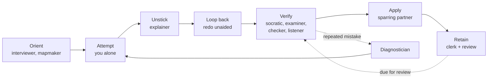

# learnloop

A system of skills for learning anything with AI, built from one idea: **learning is production, not consumption**. Reading or being explained to feels like learning, but recalling, explaining and doing are what make it stick. Most people use AI only as an explainer. This pack gives you 10 roles that make you produce something, one `learn` skill to run them, and a lifecycle that tells you which role comes next.

## Inspired by

These roles and the lifecycle are inspired by the video ["How to Use AI to Learn Anything"](https://www.youtube.com/watch?v=FSXHk4hMrY8). I recommend watching it: it explains the research behind learning by producing, and it covers the roles in more depth than this pack does. This repo is an independent implementation and is not affiliated with the video's creator.

## The lifecycle



Two rules carry the system. You attempt before anything is explained, and after an explanation you redo the whole task without help.

## Quick start

1. **Install the skill** (from the repo root; this copies one folder):
   ```
   cp -R learnloop/skills/learn ~/.claude/skills/
   ```
2. **Start with a topic:** `/learn auto <topic>`, or pick a role: `/learn interviewer <topic>`.
3. **Follow each role's "Done when" and "Next".** Every role ends by naming the next one.
4. **Keep two logs** from [examples/templates/](examples/templates/): `session-log.md` and `mistake-log.md`. The `auto` mode and the diagnostician read them.
5. **Review on a schedule.** Load the clerk's flashcards into the [practice app](examples/practice-app/) and review on day 1, 3, 7 and 21 (a default, not a rule).

## See it work: real replies

These are real replies from the skill, not mock-ups. Each was produced on 2026-10-28 by a fresh Claude Sonnet session that read only the skill files (`skills/learn/SKILL.md` and the role file it routes to) and answered one message, once. Replies are trimmed for length; `[...]` marks cuts. Your results will differ in wording.

### 1. The mapmaker gives you a route, not a list

`/learn mapmaker SQL joins` with the brief: data analyst interview on 2026-11-04, can write SELECT and WHERE, 1 hour a day, the interview is a timed live SQL test with 5 minutes per question.

<details>
<summary>The reply: 6 parts, a dated schedule, a final rehearsal, what to cut, and resources</summary>

> ### 1. Ordered parts
>
> | # | Part | Depends on | Where people get stuck | First task (alone) | Done when | Role to run |
> |---|---|---|---|---|---|---|
> | 1 | Table relationships: primary key, foreign key, one-to-many | SELECT, WHERE | Not seeing which column links two tables. Not noticing one row on one side matches many rows on the other. | Pick any 2-table sample schema (customers and orders). Write down in words which column links them and how many orders one customer can have. | You can sketch the link between any 2 tables in under 1 minute. | Attempt alone, then socratic-questioner |
> | 2 | INNER JOIN | 1 | Forgetting the ON clause. Ambiguous column names (needs table aliases). Not predicting the row count. | Write "list each order with the customer name". Before you run it, predict the row count. | 3 different INNER JOIN questions solved, each with the row count predicted correctly. | Attempt alone; explainer only if stuck |
> | 3 | LEFT JOIN (RIGHT and FULL as variants) | 2 | NULLs in the unmatched columns. Treating RIGHT/FULL as new ideas when they are LEFT flipped or combined. | Write "all customers, with their orders if any". Find a customer with no orders in the output. | You can say which rows an INNER JOIN would drop and a LEFT JOIN keeps. | Attempt alone, then examiner |
> | 4 | ON vs WHERE, and anti-joins | 3 | A WHERE filter on the right table silently turns a LEFT JOIN into an INNER JOIN. "Customers with no orders" is the classic trap. | Write "customers who never ordered". Then write it a second way with `NOT EXISTS`. | Both versions return the same rows, and you can explain why a filter in ON differs from one in WHERE. | Attempt alone; socratic-questioner to verify |
> | [...] | parts 5 and 6: joins with GROUP BY and HAVING; multi-table and self joins | | | | | |
>
> ### 2. Dated schedule (1 hour a day)
>
> | Date | Day | Plan |
> |---|---|---|
> | 2026-10-28 | Wed | Parts 1 and 2. 15 minutes on the schema idea, 45 minutes on INNER JOIN practice. |
> | 2026-10-29 | Thu | Part 3. LEFT JOIN, then RIGHT/FULL as variants. |
> | 2026-10-30 | Fri | Part 4. ON vs WHERE and anti-joins. |
> | 2026-10-31 | Sat | **Halfway review.** Run the examiner on parts 1 to 4, with 5 minutes per question. Log every mistake. |
> | [...] | | |
> | 2026-11-03 | Tue | **Final rehearsal** (below). Light review of your mistake list afterwards. |
> | 2026-11-04 | Wed | Interview. Do no new learning. Re-read your mistake list only. |
>
> ### 3. Final rehearsal and what "ready" means
>
> **Rehearsal on 2026-11-03:** a timed set of 6 join questions, with a hard 5-minute limit per question. That is 30 minutes in total. Use a SQL editor and a question set you have not seen. Do not look up syntax.
>
> **"Ready" means:** at least 4 of 6 correct within the time limit, and every miss is something you can explain, not a total blank. If you fall short, spend the remaining time on the part you missed, not on new topics. This is a plan and the rehearsal is the test. I can't promise you will be ready.
>
> ### 4. Cut first (in this order, if you fall behind)
>
> 1. RIGHT and FULL JOIN: treat them as "LEFT JOIN flipped" and skip drills.
> 2. Part 6 self joins: keep only 3-table joins.
> 3. Part 1: shrink to a 10-minute read.
>
> Never cut parts 2, 3, 4 or 5. They are the core of a timed join test.
>
> ### 5. Resources and your very next task
>
> Check every link before you rely on it. I only name resources I am sure exist, and I am not certain of exact lesson titles or current URLs.
>
> - **Interactive lessons:** SQLBolt (primary for parts 1 to 3); Mode SQL Tutorial (primary for part 4).
> - **Practice:** LeetCode SQL problems (parts 5 and 6 and the rehearsal); SQLZoo for extra reps.
> - **Video:** freeCodeCamp's full SQL course for beginners on YouTube, joins section only. "I am not sure of the exact timestamps, so search for the joins part."
> - **Books:** *Learning SQL* by Alan Beaulieu, reference only. "At 1 hour a day you do not have time to read it."
>
> **Very next task (today, Wed 2026-10-28):** open SQLBolt and write, without reading the solution first, a query that joins customers to orders and lists each order with the customer name. Predict the row count before you run it.

</details>

### 2. It will not explain until you try

`/learn explainer rate limiting. I don't get how rate limiting works, can you explain it?`

> The attempt gate stops me here. I won't run the explainer yet.
>
> You haven't pasted an attempt at a task, and you haven't named where you got stuck. This role only explains the one point you're stuck on, after you've tried. That's because reading an explanation doesn't teach you much. Trying first and then redoing the task alone does.
>
> **Try this first (about 5 minutes, no looking anything up):**
>
> 1. In your own words, write what you think rate limiting is for. What problem does it solve?
> 2. Imagine an API that must allow at most 100 requests per minute per user. Sketch how you'd build it. Say what you'd store and what you'd check on each request.
> 3. Mark the exact spot where you get stuck or start guessing.
>
> Paste your attempt and the stuck point here. I'll explain just that part, at your level, with one small example. After that you'll redo the whole task from the start, without help. [...]

### 3. It asks instead of telling

The AI had asked "why does a token bucket compute its refill when a request arrives, instead of using a timer?". The learner replied: "I have no idea. Just tell me the answer, I'm short on time."

> That's a gap, and I've noted it: "why refill on request arrival instead of a timer" is unanswered. I won't give you the answer. That's how this role works, and it's quicker than it sounds because the next question is much smaller.
>
> Suppose a million different users each have their own bucket, and most of them are idle right now. If every bucket had its own timer adding a token every second, what would your server be doing for the buckets nobody is using?
>
> Give me one sentence, even a guess. [...]

### 4. It stops when you start guessing

During an exam on token buckets, the learner answered a level-3 question with "idk, maybe A? I'm just guessing here."

> Stopping the exam here. A guess with no reasoning is the cue to stop, so I'm scoring level 3 as wrong. I won't round it up.
>
> **Result: passed levels 1 and 2, failed level 3. Level reached: 2.**
>
> [...]
>
> **Next review date:** 2026-10-31. Only level 3 and up will be quizzed.
>
> [...]
>
> **Next role:** clerk. Turn the missed level 3 item into a flashcard, written in your own words. If the same kind of miss comes back, we'll move to the diagnostician.

To see all ten roles used once on one topic, read the [worked example](examples/rate-limiting/lifecycle.md): learn HTTP rate limiting, then build it. That one is written by hand, not a recorded session.

## I want to... run this

| I want to | Run |
|---|---|
| Work out what I need to learn and how I'll be tested | `/learn interviewer <topic>` |
| Get a plan, a schedule and resources for a subject | `/learn mapmaker <topic>` |
| Get unstuck (after I tried) | `/learn explainer <topic>` |
| Find out whether I really understand it | `/learn socratic-questioner <topic>` |
| Get a score and my level | `/learn examiner <topic>` |
| Have something I made graded | `/learn checker` |
| Check my explanation against a source | `/learn listener` |
| Find why I keep making the same mistake | `/learn diagnostician` |
| Practise a real-world skill under pressure | `/learn sparring-partner <scenario>` |
| Turn notes and mistakes into cards | `/learn clerk` |
| Not sure what is next | `/learn auto <topic>` |

## What is here

```
learnloop/
├── README.md
├── skills/learn/       SKILL.md (router, attempt gate, guardrails) and roles/ (10 role files)
├── docs/
│   ├── roles.md        what each role is for, when to use it, how it connects
│   ├── lifecycle.md    the stages, the diagrams, the principles
│   ├── acceptance.md   the video's claims as probes, with results
│   └── plans/          the build plan and the gap-closing plan
├── examples/
│   ├── templates/      blank brief, map, logs, rubric, flashcards
│   ├── practice-app/   single-file flashcard app with spaced review
│   └── rate-limiting/  worked example: lifecycle.md and a tested Node project
└── context/            the source video transcript, notes and images
```

## Read next

- [docs/roles.md](docs/roles.md): each role, its purpose, when to use it and how it connects.
- [docs/lifecycle.md](docs/lifecycle.md): the full flow, the principles, and when not to use AI.
- [docs/acceptance.md](docs/acceptance.md): how the skill was tested against the video, and the limits of that test.

## Status

Built and tested: all 19 acceptance probes pass (one model, one run each; see the limits in the acceptance file). The replies above are from those probes. The skill is not installed by this repo; step 1 above installs it.
