# Using AI to Learn Anything Faster: Notes

Source: video transcript (speaker: behavioral-neuroscience background, runs a business doing $400k+/month). Core claim: AI should augment your *production* of knowledge, not replace the struggle with passive consumption.

## 1. How humans actually learn

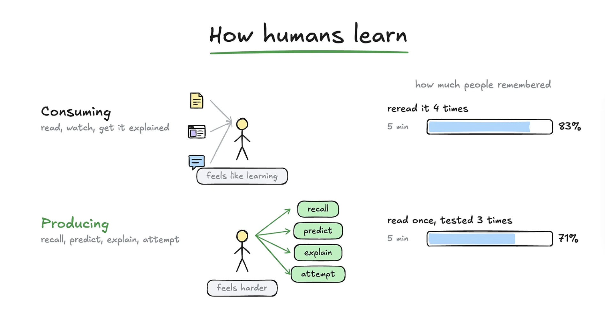

| Mode | Activities | Feels like | Actual result |
|---|---|---|---|
| Consuming | read, watch, get it explained | learning (easy) | weak long-term retention |
| Producing | recall, predict, explain, attempt | harder | strong long-term retention |

Brain avoids production because it costs energy. That is why people default to rereading.

### Study data (retention)

| Group | After 5 min | After 1 week |
|---|---|---|
| Reread source 4 times | 83% | ~40% |
| Read once, tested 3 times | 71% | ~61% |

- Reread group decayed ~40+ points (>50% relative loss); tested group lost ~10 points.
- What matters: retention after a week, month, year, not 5 minutes.
- Takeaway: use AI to boost **active production**, not passive reading.

## 2. The 10 roles AI can play

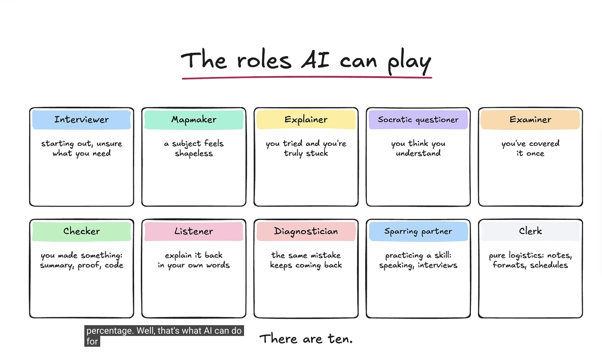

Most people only ever use #3 (Explainer), which is passive. The other nine are production-focused.

| # | Role | Use when | What you ask AI to do |
|---|---|---|---|
| 1 | Interviewer | Starting out, unsure what you need | Ask you questions about goal, level, constraints before teaching anything |
| 2 | Mapmaker | Subject feels shapeless | Build a curriculum / roadmap |
| 3 | Explainer | Tried and truly stuck | Explain just the stuck part at your level |
| 4 | Socratic questioner | You think you understand | Ask questions, never hand over the answer |
| 5 | Examiner | You've covered a topic once | Quiz and score you; locate your level |
| 6 | Checker | You made something (summary, proof, code, math) | Grade your process and reasoning against a rubric |
| 7 | Listener | Explaining it back in your own words | Compare your explanation to the source, report gaps |
| 8 | Diagnostician | Same mistake keeps returning | Find the shared root misunderstanding across past sessions |
| 9 | Sparring partner | Practicing a real-world skill (speaking, interviews, sales calls) | Simulate the situation under pressure |
| 10 | Clerk | Pure logistics: notes, formats, schedules | Clean outlines, flashcards, scheduling |

## 3. Role details and prompts

### Interviewer

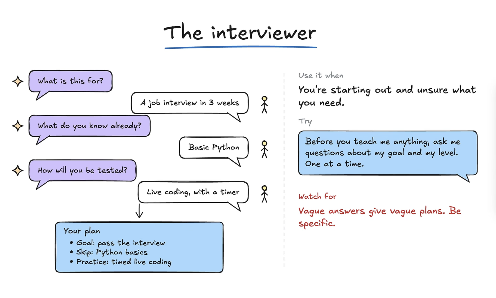
- Don't say "help me learn X". Say "drill me on everything to find what I already know about X".
- AI uncovers the *real* goal. Example: goal "learn coding" becomes "pass a live-coding interview in 3 weeks", so skip Python basics, practice timed live coding.
- Questions it should cover: goal, current level, how you'll be tested, timeline.
- Watch for **vague answers**. Be specific: "interview on LeetCode, know basic Python up to HTTP requests, 5 min per question, from this question bank".
- Prompt: *"Before you teach me anything about X, ask me questions about my goal, my level, and everything you need to make this effective."*

### Mapmaker

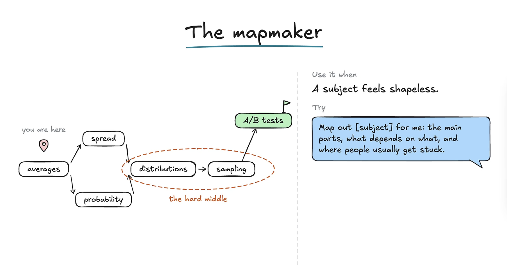
- Without a plan, most energy goes to anxiety about "what next". A plan, even imperfect, boosts productivity.
- Example: Statistics → averages → spread & probability → distributions → sampling → A/B testing.
- Ask for: main parts, dependencies between parts, where people usually get stuck.
- Prompt: *"Map out X for me. Main parts, what depends on what, and where people usually get stuck, so I can plan my time."*

### Explainer

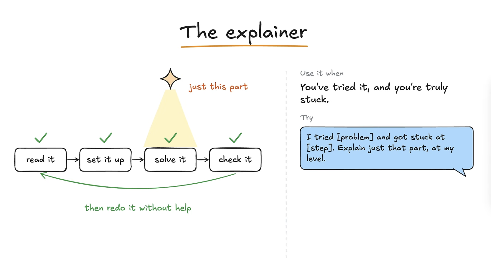
- Useful, but only complete with the **loop-back step**: after you get unstuck and finish, go back to step one and redo the whole task from scratch, **without help**.
- Understanding an explanation is not the same as being able to do it. Nodding along = read about it, not learned it.
- Costs only ~10-15% extra time; payoff is large.
- Prompt: *"I tried doing X, got stuck at Y. Explain just that part at my knowledge level."* Then circle back and finish yourself.

### Socratic questioner

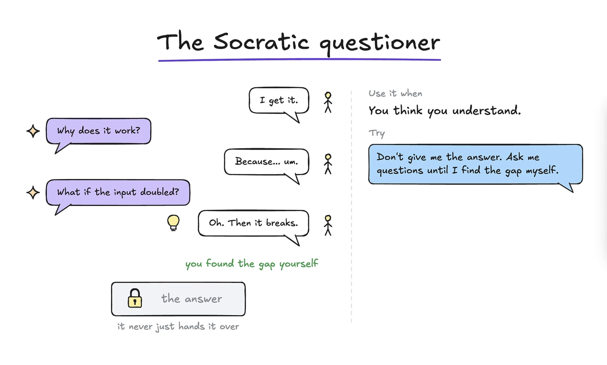
- AI acts as study buddy: "Why does this principle work?" then follow-ups ("what if the input doubles?").
- Exposes gaps to both you and the AI. Never hands the answer over; forces you to produce it.
- Loop: Socratic → Explainer → new Map → repeat.
- Prompt: *"I want to learn X. Don't give me the answer. Ask questions until I find what I don't know myself."*

### Examiner

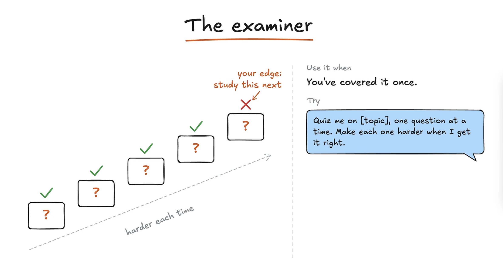
- Tiered exam (level 1 to 5): find where you stop passing, that is where to go next.
- Goal of all this: maximally direct your learning. Traditional formats (lectures) squeeze out only ~10-20% of potential.
- Prompt: *"Quiz me on this topic, one question at a time. Make each harder until I get things wrong, then tell me where the gap is."*

### Checker

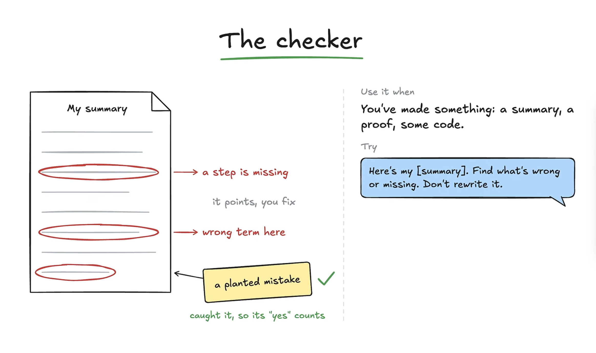
- Like "show your work" in math class: grades the **process**, not just the result.
- Finds faster or shorter paths (e.g. summary cut to half length), so next time your *process* is faster.
- Prompt: *"Here's my work for X. Find what's wrong or missing, and tell me if there's a faster or easier way. Don't rewrite any of it."*

### Listener

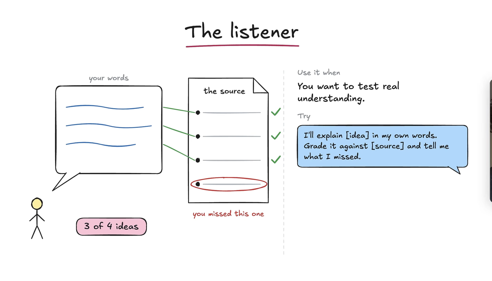
- Demonstrate knowledge in multiple formats: verbal, visual, written. Best learners can do all.
- Speaker's workflow: (1) voice-transcribe an explanation, (2) draw a quick image of the concept, (3) write a short succinct version (voice transcripts run long). Feed all three to AI to compare against the source (e.g. a neural network architecture paper).
- Prompt: *"I'll explain this idea in my own words. Grade it against the source and tell me exactly what I missed."*

### Diagnostician

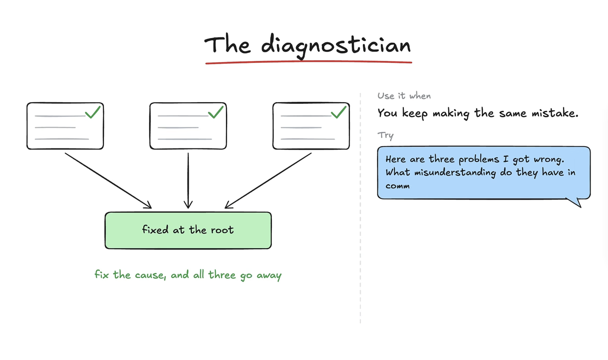
- Many mistakes across subjects share one root (e.g. weak grasp of a basic math operation breaks statistics, biology, chemistry tasks).
- Feed AI your past sessions (e.g. last 100 conversations) and ask for the recurring reasoning error. Fix the root, not each symptom.
- Prompt: *"Here are things I keep getting wrong. What misunderstanding do they all have in common?"*

### Sparring partner

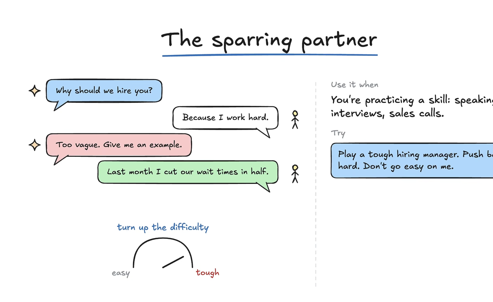
- For real-world skills: public speaking, interviews, negotiations, sales calls.
- Adjustable difficulty: shorter answer timers (e.g. 30 s), tougher interviewer, push-back.
- Example: "Why should we hire you?" → "I work hard" → AI says too vague, give an example → "Last month I cut wait times in half" (should have led with that).
- Not identical to real life, but gives a rough first rep, which makes you significantly better.
- Prompt: *"Play a tough hiring manager for X. Here's a list of previous interviews they've done. Don't go easy, push back hard. Every answer must be generated in 30 seconds."*

### Clerk

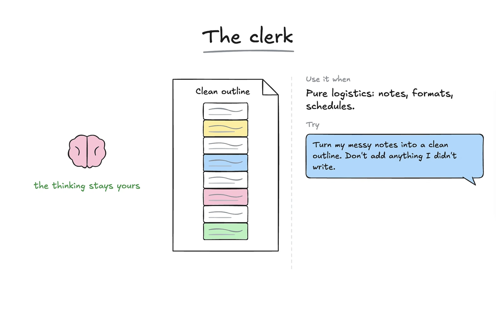
- Messy notes → clean outline → flashcards. All thinking stays yours; AI only organizes.
- Prompt: *"Turn my messy notes into a clean outline. Don't add anything I didn't write. Make the hierarchy clear."*

## 4. Spaced repetition

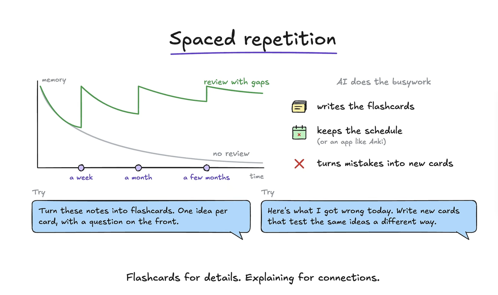

- Ebbinghaus forgetting curve: without review, memory decays roughly exponentially.
- With review at gaps (about a week, a month, a few months): each review makes memory last longer (flatter curve) and dip less far.
- Result: studying a few minutes to refresh beats restudying from scratch; claimed 5-10x efficiency per unit time.
- AI's job: write flashcards, keep the schedule (or use an app like Anki), turn mistakes from sparring/listening sessions into new cards.
- Example: learning a car engine: pistons, cylinders, four stages of combustion (intake...).
- Prompts:
  - *"Turn these notes into flashcards. One idea per card, with a question on the front."*
  - *"Here's what I got wrong today. Write new cards that test the same ideas a different way."*
- Rule of thumb: **Flashcards for details. Explaining for connections.**

## 5. High-level principles

### Find stuff at your level (zone of proximal development)

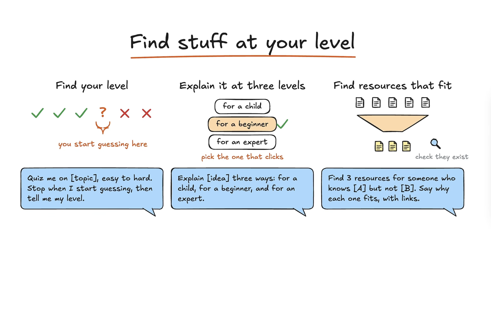
- You learn most when pushed slightly outside your comfort zone: not too easy, not too hard.
- Prompt: *"Quiz me on X from easy to hard. Stop when I start guessing. Then tell me my level."* Then continue with other roles.
- Ask for explanations at several levels (child, beginner, teenager, expert) to gauge vocabulary and nuance gaps.
- Ask AI to find the **best human-made explanations** for your level (include what you know/don't know), with reasons and links. Humans are still the arbiters of taste for clear explanations; the right one can save days to months.

### Simulation

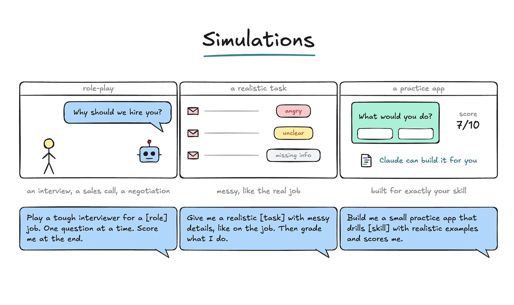
- Role-play (e.g. tough interviewer, one question at a time, score at the end).
- Realistic tasks: AI generates emails/customer concerns, you respond, AI grades the end result and/or the process.
- Have Claude/Codex-style agents build **practice apps**: flashcard blitzes, visualization/drawing exercises. Cheap, and covers text, verbal, and visual. Loop: run, get feedback, make harder, rerun ("hyperbolic time chamber for knowledge").

### Case against AI

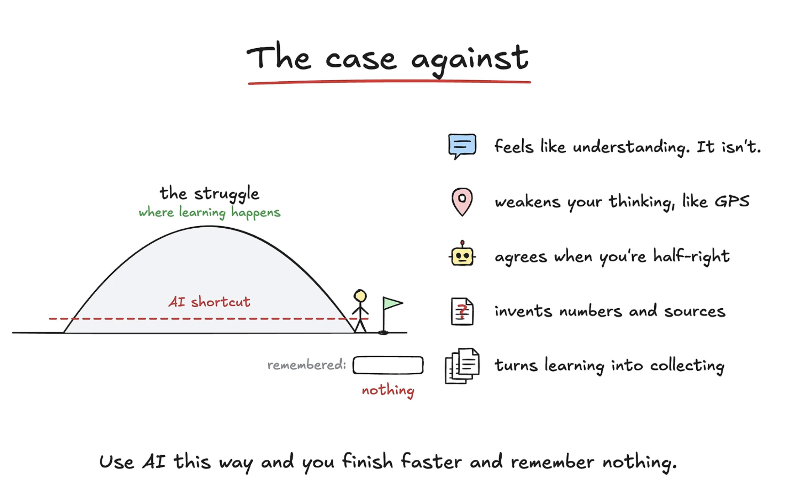
- Learning happens **during the struggle**. AI can shortcut the difficulty hump, leaving you remembering nothing.
- An explanation feels like understanding but isn't.
- Analogy: GPS users build poorer mental maps; offloading thinking weakens the regions that do the reasoning.
- Risks: AI agrees when you're half right, invents numbers and sources, turns learning into collecting notes.
- Mitigation: don't use AI the default way. Be strategic: keep producing, use AI as a thought partner. Same as any tech (social media has good uses, default usage is poor).

## 6. Recommended workflow (synthesis)

1. **Interviewer**: pin down goal, level, test format.
2. **Mapmaker**: get curriculum, dependencies, sticking points.
3. Attempt the task yourself first.
4. **Explainer** only for the stuck part.
5. **Loop back**: redo the whole thing unaided.
6. **Socratic / Examiner / Checker / Listener**: verify understanding (written, verbal, visual).
7. **Diagnostician**: periodically find root misconceptions.
8. **Sparring partner / simulation**: practice real-world performance.
9. **Clerk**: outline + flashcards; review on a spaced schedule.

## Key quotes / one-liners
- Learning is production, not passive consumption.
- If you can't redo it without help, you've read about it, not learned it.
- Flashcards for details. Explaining for connections.
- Target outcome: maximally direct your learning.
