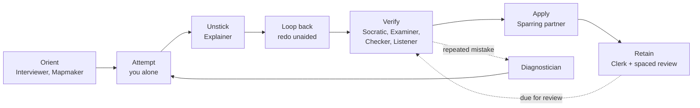
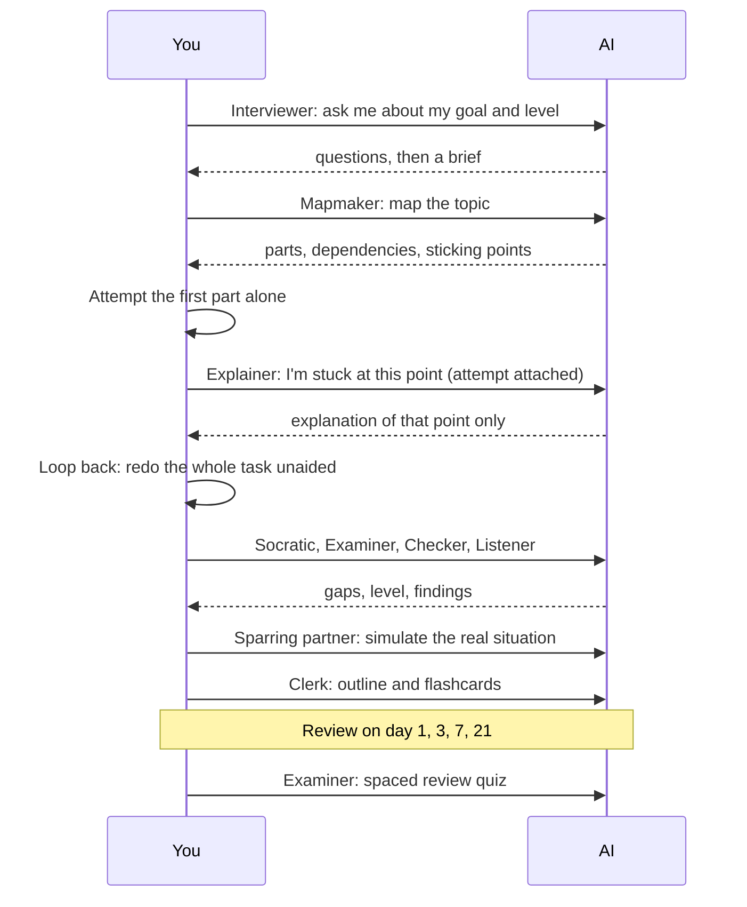
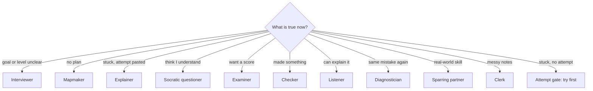

# The learning lifecycle

[roles.md](roles.md) says what each role is. This page says how they run together, from the first question to a spaced-review schedule, and what to do at each stage.

## Why this order

Retention data from the source: reread a document four times and you remember 83% after 5 minutes but about 40% after a week. Read it once and test yourself three times and you remember 71% after 5 minutes but about 61% after a week. Testing yourself wins over time. The lifecycle is built so that every stage makes you produce something.

## The six stages

The stages group the nine workflow steps in the notes without changing their order. Dotted arrows are loops.

| Stage | Roles | What you do | Done when |
|---|---|---|---|
| **Orient** | Interviewer, Mapmaker | Pin down goal, level, test format and timeline. Get a map. | You have a brief and a map, and know your next small task. |
| **Attempt** | none, you alone | Try the task before getting any help. | You have an attempt (even a wrong one) and know where you got stuck. |
| **Unstick** | Explainer | Get only the stuck part explained, at your level. | You can continue the task. |
| **Loop back** | none, you alone | Redo the whole task from the start without help. | You finished it unaided. If not, return to Unstick. |
| **Verify** | Socratic, Examiner, Checker, Listener | Check understanding by questions, a scored quiz, a work review and an explain-back. | Examiner level and Checker findings are recorded; gaps are listed. |
| **Apply** | Sparring partner | Practise the real-world version under pressure. | You scored acceptably at your target difficulty. |
| **Retain** | Clerk | Turn notes and mistakes into an outline and flashcards. Review on a schedule. | Cards exist and the next review date is set. |

The **Diagnostician** is not a stage. Run it whenever the same mistake appears twice, or every few sessions as a routine check.

## One pass in time

This sequence shows one pass for a single topic, including the loop back and the first spaced review.

## Choosing a role at any moment

If you are not sure where you are, use this chooser. It is the same logic `/learn auto` follows.

## Principles

1. **Production over consumption.** Every role makes you produce (answer, explain, build, redo) or checks something you produced.
2. **Attempt first.** The Explainer is the only consuming role and runs only after an attempt.
3. **Loop back.** After any explanation, redo the whole task without help. It costs about 10 to 15% extra time and is where the learning happens.
4. **Exit criteria, not feelings.** Every role ends with a checkable "done when", so you move on from evidence, not from a sense of understanding.
5. **AI organises, you think.** The Clerk adds nothing you did not write, the Checker does not rewrite your work, and the Socratic questioner does not answer for you.
6. **Distrust the AI.** It can agree when you are half right and can invent numbers and sources. Ask for sources and check numbers.

## Three habits that run through every stage

### Find your level

You learn most when a task is slightly beyond your reach. Ask the Examiner to go from easy to hard and stop when you start guessing; that is your level. To judge vocabulary, ask for the same explanation at several levels (child, beginner, high schooler, expert). To save time, ask the AI to find the best human-written explanations for your level, with reasons and links, and use the one that clicks.

### Space your reviews

Without review, memory decays roughly exponentially (the Ebbinghaus forgetting curve). Each review makes the memory last longer and dip less far. A few minutes of review beats restudying from scratch.

- **Default schedule:** review on day 1, 3, 7 and 21 after learning. This schedule is an assumption, a common starting point; change it to suit you.
- **Flashcards for details, explaining for connections.** Use cards for facts and the Listener for how ideas connect.
- Mistakes from the Examiner, Checker, Listener or Sparring partner become new cards that test the same idea in a different way.
- The [practice app](../examples/practice-app/) schedules cards in boxes for you.

### Simulate and practise

Role-play a tough interviewer, or have an AI agent build a practice app (flashcard blitz, drawing exercises). Run it, get feedback, make it harder, run it again. This is the Sparring partner's job and covers text, speech and visuals cheaply.

## When not to use AI

Learning happens during the struggle. If AI removes the struggle, you remember little: an explanation feels like understanding but is not. Like a GPS weakens your sense of direction, offloading the thinking weakens the thinking.

Use these rules to avoid it:

- Attempt before asking. Redo after being helped.
- Ask for questions, not answers (Socratic, Examiner).
- Treat AI output as a claim to check, especially numbers and sources.
- If you only collect notes and never produce, stop and run the Examiner.
