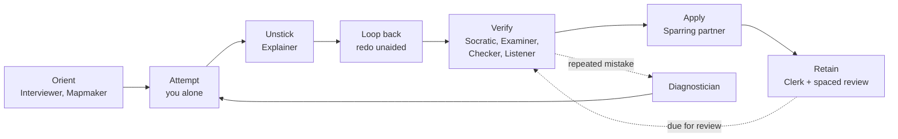
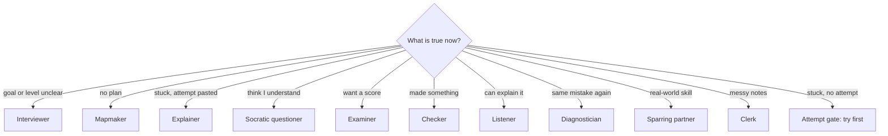
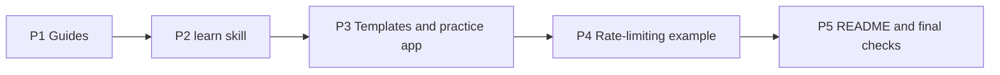

# Plan: Learnloop, a system of skills for learning with AI
Status: built on 2026-10-28        Date: 2026-10-28        Read time: about 26 min        Method: read both source files, the sibling `plan-skills` pack and its README; no code run yet        Now: built; nothing pending

## How to read this plan

| Part | For whom | Take it alone for |
|---|---|---|
| Shared understanding | you and the agent | agreeing on the problem and the choices before any file is written |
| For you to understand | the human reader | judging the plan and learning what gets built |
| Agent implementation order | the executing agent | building it phase by phase |

## Shared understanding

### Playback

1. **Problem.** The notes and transcript describe 10 AI learning roles and a 9-step workflow, but only as reading material. Nothing lets you pick a role, run it, and be led to the next one, so you will fall back to the one role most people use, the Explainer, which is passive.
2. **Done looks like.** You open `learnloop/`, choose any role (or let `/learn auto` choose), follow it, and always know the next step from first question to a spaced-review schedule. One real example, learning HTTP rate limiting and then adding it to a small server, shows every role used once.
3. **Constraints.** Build on the source ideas, add nothing they do not support. Simple, reusable, domain-agnostic. Do not touch `learnloop/context/` (transcript, timestamps, notes, images) or `plan-skills/`. No commits, branches or worktrees (AGENTS.md). Do not install anything into `~/.claude/skills/`.
4. **Assumptions.** See Assumptions below.
5. **Out of scope.** See Not in scope below.

Most likely wrong point: that the practice app should be a plain single HTML file with no build step. Confirmed by you: one `learn` skill with 10 role modes, HTTP rate limiting as the example, 10 roles with principles as cross-cutting rules.

### Decisions (locked)

| # | Decision | Choice | Why |
|---|---|---|---|
| D1 | Skill form | One skill `learn` at `skills/learn/SKILL.md`; each role is a short file in `skills/learn/roles/` that the skill reads on demand | You chose one skill with 10 modes. Splitting roles into files keeps SKILL.md short and each role reusable on its own |
| D2 | Home | Everything inside `learnloop/` | Notes and sources already live there; `plan-skills/` is a sibling pack with the same shape |
| D3 | Role set | Exactly the 10 roles in the notes. Spaced repetition, find-your-level, simulation and the case against AI become rules in `lifecycle.md`, not roles | The notes list 10 roles and treat the rest as "principles" (section 5) |
| D4 | Lifecycle | Six stages: Orient, Attempt, Unstick, Verify, Apply, Retain, with a loop-back after Unstick and a Diagnose check on repeated mistakes | Notes section 6 is a 9-step workflow; the six stages group it without changing the order |
| D5 | Attempt gate | The `learn` skill will not run Explainer until the learner has pasted an attempt | Transcript 00:11:22 and 00:27:02: explaining before trying is passive consumption. One rule, enforced in one place |
| D6 | Example | HTTP rate limiting (token bucket). Project: zero-dependency Node server with `limiter.js` and tests using `node:test` | You chose it. Zero dependencies means `node --test` runs with nothing installed |
| D7 | Practice app | One `index.html`, [Leitner](https://en.wikipedia.org/wiki/Leitner_system) boxes (cards move up a box when right, back to box 1 when wrong), saved in the browser's `localStorage`, cards loaded from a JSON paste | Transcript 00:25:33 says practice apps are cheap; no build, no server |
| D8 | Honesty of the example | Example artifacts are written by hand to show the shape of each role's output, and say so at the top. They are not a captured AI session | Avoids presenting invented output as a real transcript |
| D9 | Images | Reuse the 16 PNGs in `learnloop/context/images/` by relative link; generate none | They already cover all 10 roles, spaced repetition and the principles |

### Scope cut

- **Removed:** one skill per role (you chose one skill); a CLI or database to track progress (a markdown session log does the job); Anki export (a plain `flashcards.csv` imports into Anki already); new images; a plan-for style checker script; any `.html` page generator.
- **Kept small:** each role file is one page with a fixed seven-heading template; the worked example uses a toy limiter (one file, about 40 lines), not a production one.
- **Touched outside the pack:** one row in the root `README.md`, which is stale today (see Trap 1).

### Changes

| Date | What changed | Why | Cards affected |
|---|---|---|---|
| 2026-10-28 | P4 artifacts simplified: the 13 files in `artifacts/` and `walkthrough.md` replaced by one Q&A file, `examples/rate-limiting/lifecycle.md`. D8 still applies | User asked for a simpler example as one AI question-and-answer conversation | P4 (Touches and Validate now: `project/` plus `lifecycle.md`) |

### Assumptions

| Assumption | Status | Source or note |
|---|---|---|
| The 10 roles and their prompts in the notes are the source of truth | verified | `learnloop/context/ai-learning-roles.md:27-45` |
| `node` is installed and supports `node --test` | verified | `node --version` printed v26.5.0 on 2026-10-28 |
| The user will install the skill by copying `skills/learn` to `~/.claude/skills/` | assumed | Same install shape as `plan-skills/README.md:31-36`; reversible |
| Diagram syntax is checked by parsing the Mermaid blocks in a headless browser | assumed | `mmdc` is not installed; I will not add a dependency just for this |
| Simulation and the practice-app builder belong to Sparring partner and the Clerk, not a new role | user-confirmed | Playback question answered "Yes, that is right" |

### Open questions

None.

## For you to understand

### In one minute

- **What:** a `learn` skill with 10 role modes, two guide docs with Mermaid diagrams, templates, a flashcard practice app, and one full worked example (learn HTTP rate limiting, then build it).
- **Why:** the video's core claim is that learning is production, not reading. A system that routes you through the roles, and forces an attempt before an explanation, makes that the default.
- **Biggest risk:** the guides and the role files say the same thing twice and drift apart. Mitigation: `roles.md` holds purpose and connections only; each role file is the only place its prompt lives.
- **Effort:** about 2.5 days of agent work in 5 phases.
- **Not touched:** the transcript, timestamps, notes, `plan-skills/`, and `~/.claude/skills/`.

### Where we start

| Fact | Source | Date |
|---|---|---|
| `learnloop/` held `notes/`, `transcript.md`, `timestamps.md` and nothing else; on 2026-10-28 these were moved into `learnloop/context/` | `ls learnloop` | 2026-10-28 |
| The notes define 10 roles in a table: use-when and what to ask | `learnloop/context/ai-learning-roles.md:33-44` | 2026-10-28 |
| Each role has a ready prompt | `learnloop/context/ai-learning-roles.md:48-122` | 2026-10-28 |
| The notes give a 9-step recommended workflow | `learnloop/context/ai-learning-roles.md:164-174` | 2026-10-28 |
| Spaced repetition prompts and the rule "Flashcards for details. Explaining for connections." | `learnloop/context/ai-learning-roles.md:124-136` | 2026-10-28 |
| 16 PNGs exist: `01-roles-overview.png` to `16-case-against-ai.png` | `ls learnloop/context/images` | 2026-10-28 |
| A sibling pack has `README.md`, `core/`, `skills/<name>/SKILL.md`, `docs/`, `examples/` | `plan-skills/README.md:56-68` | 2026-10-28 |
| Skills use `name` and `description` frontmatter | `plan-skills/skills/plan-for-feature/SKILL.md:1-5` | 2026-10-28 |
| `.gitignore` ignores `node_modules/` and `.DS_Store` | `.gitignore:1-2` | 2026-10-28 |

### Trap 1: the root README is stale

`README.md:8` says `learnloop` holds `PRD.md` and `TRD.md` and is "Spec only, not built". Neither file exists. P5 corrects the row and the layout block.

> **Warning:** do not write links to `PRD.md` or `TRD.md`; they would be dead.

### Trap 2: image paths depend on the file's folder

The notes link images as `images/02-how-humans-learn.png`. From `learnloop/docs/` the same file is `../context/images/02-how-humans-learn.png`. A wrong prefix shows a broken picture, not an error.

> **Warning:** the P5 link check resolves every relative image and link, so a wrong prefix fails the phase.

### Principles

1. **Production over consumption.** Every role makes you produce (answer, explain, build, redo) or checks something you produced.
2. **Attempt first.** Explainer is the only consuming role and runs only after an attempt (D5).
3. **Loop back.** After any explanation, redo the whole task without help. This is 10-15% extra time (notes line 70).
4. **Exit criteria, not feelings.** Every role ends with a checkable "done when", so you move on from evidence, not a sense of understanding.
5. **AI organises, you think.** Clerk adds nothing you did not write; Checker does not rewrite; Socratic does not answer.
6. **Distrust the AI.** Ask for sources, check invented numbers (notes line 161).

### Pictures

Planned diagrams, drawn as [Mermaid](https://mermaid.js.org/intro/syntax-reference.html) in the docs. This one shows how the stages connect; it is what `lifecycle.md` will contain.



This one shows how `/learn auto` picks a role from what you say.



### Risks and still unverified

| Risk | Why | Mitigation |
|---|---|---|
| Guides and role files drift | The same role is described in two places | `roles.md` links each role file for the prompt; P5 greps that no prompt text is duplicated |
| Router picks wrongly | `auto` guesses the stage from free text | It asks one question when unsure and states why it chose the role; you can override with `/learn <role>` |
| Example artifacts read as real output | They are hand-written | D8 label at the top of each artifact file |
| Mermaid syntax errors | Rendering differs between viewers | P1 and P5 parse every block in a browser |
| Practice app loses cards | `localStorage` is per browser | The app has an Export button that downloads the JSON; noted in its README |

### How the code works

#### The picture in one paragraph

Learnloop is one skill called `learn`, plus guides and examples. When you run `/learn` with a role name, Claude reads a short instruction file for that role and plays it: it asks you questions, grades your work, or plans your study, but it does not do the thinking for you. One rule is built into the skill itself: the explainer role will not run until you have tried the task. Almost everything is plain Markdown. The only real code is a small flashcard web page and a tiny rate-limiting server used as the worked example.

#### Follow one run

First, what happens when you type `/learn explainer <topic>`:

1. Claude loads the installed skill at `~/.claude/skills/learn/SKILL.md`, a copy of `learnloop/skills/learn/SKILL.md`.
2. `learnloop/skills/learn/SKILL.md:12` ("Run a role") says to read the role file beside it, `roles/explainer.md`.
3. `learnloop/skills/learn/SKILL.md:41` (the attempt gate): if you have not pasted an attempt and named where you got stuck, Claude refuses and offers the interviewer or mapmaker instead. It stops there.
4. `learnloop/skills/learn/roles/explainer.md:19-23` ("How it runs"): explain only the stuck point, give four levels if you ask, then tell you to finish the task and redo all of it from the start without help.
5. `learnloop/skills/learn/SKILL.md:45` (guardrails) applies the whole time: no invented sources, no just agreeing with you.
6. `learnloop/skills/learn/SKILL.md:53` (logs): Claude offers to add one line to `session-log.md` and creates the file only if you agree.
7. `learnloop/skills/learn/roles/explainer.md:37-41` ("Done when" and "Next"): once you redid the task, the next role is the socratic questioner.

Second, what happens when a request reaches the example server (`GET /ping`):

1. `learnloop/examples/rate-limiting/project/server.js:16` calls `limiter.take()`.
2. `learnloop/examples/rate-limiting/project/limiter.js:16-21` runs `take()`, which first calls `refill()` (lines 8-13). Line 10 turns elapsed milliseconds into seconds; line 11 adds tokens and caps them at capacity.
3. If fewer than 1 token is left, `take()` returns false (line 18). `learnloop/examples/rate-limiting/project/server.js:17` then answers 429 with a `Retry-After` header from `retryAfterSec()` (`limiter.js:23-27`).
4. Otherwise one token is removed and the server answers 200.

#### File by file

| File | Job in one sentence | Key function | Why it looks this way |
|---|---|---|---|
| `learnloop/skills/learn/SKILL.md` | Routes `/learn <role>`, holds the attempt gate and the guardrails | none, it is instructions | One skill with roles in separate files keeps it short (D1) |
| `learnloop/skills/learn/roles/explainer.md` | Instructions for the explainer role | none | Every role file has the same eight headings so each can be read alone |
| `learnloop/skills/learn/roles/mapmaker.md` | Instructions for the mapmaker, including the resource list | none | Same eight headings; the other eight role files follow the same shape |
| `learnloop/docs/roles.md` | Says what each role is for, when to use it and how it connects | none | Links to the role files and does not copy prompts, so the two cannot drift |
| `learnloop/docs/lifecycle.md` | Shows the six stages, the diagrams and the principles | none | Separates "how the roles flow" from "what each role is" |
| `learnloop/docs/acceptance.md` | Lists the video's claims as probes, with results | none | Makes the test repeatable and reviewable |
| `learnloop/examples/templates/session-log.md` | Blank log that `auto` mode and the diagnostician read | none | Plain Markdown tables, no tooling (D8 scope cut) |
| `learnloop/examples/practice-app/index.html` | Flashcard app with five review boxes | `render()`, `mark()`, `load()`, `save()` | One file, no build, cards kept in `localStorage` (D7) |
| `learnloop/examples/rate-limiting/project/limiter.js` | Token-bucket limiter | `createLimiter()`, `take()`, `retryAfterSec()` | Lazy refill, so no timer; one `refill()` shared by both methods |
| `learnloop/examples/rate-limiting/project/limiter.test.js` | Five tests using a fake clock | none | The clock is passed in as `now`, so tests control time |
| `learnloop/examples/rate-limiting/project/server.js` | Returns 200 or 429 on `GET /ping` | none | One global bucket keeps the example small |
| `learnloop/examples/rate-limiting/lifecycle.md` | Hand-written Q&A that uses every role once | none | Shows each role's input, output and exit check |
| `learnloop/README.md` | Front door: lifecycle, quick start, role chooser, folder map | none | One place to start |

#### Things that will surprise you

- **Roles are text, not code.** Behaviour comes from the instructions, so changing a role file changes what the role does. There is no compiler to catch a mistake; the probes in `docs/acceptance.md` are the test.
- **The installed skill is a copy.** `~/.claude/skills/learn/` does not follow the repo. After an edit, run `cp -R learnloop/skills/learn ~/.claude/skills/` again. A new session may be needed to load it.
- **Units in `limiter.js`.** `Date.now()` is milliseconds and the refill rate is per second. Line 10 converts once and names the unit. Mixing them makes the bucket refill 1000 times too fast; this is the planted mistake in the example.
- **One bucket for everyone.** `server.js` has a single global bucket, on purpose. A real limiter needs one per client.
- **Cards live in one browser.** The practice app saves to that browser's `localStorage`; use Export JSON for a backup.
- **Sources moved.** The video transcript, notes and images are in `learnloop/context/`, so guide images link to `../context/images/`.
- **A pass is not a guarantee.** The probes ran on one model, once each, written by the author.

#### How to change it safely

- **Add or change a role:** edit its file in `learnloop/skills/learn/roles/`, keep the eight headings, update the table at `learnloop/skills/learn/SKILL.md:18` and the matching section of `learnloop/docs/roles.md`, then reinstall the skill.
- **Add a claim to test:** add a row to `learnloop/docs/acceptance.md`, run its probe, record the result.
- **Prove nothing broke:** for the code, run `cd learnloop/examples/rate-limiting/project && node --test` (5 tests pass). For the role files, `grep -L '^## Done when' learnloop/skills/learn/roles/*.md` prints nothing. The link and diagram check used in P5 was a throwaway script and is not kept in the repo.

### References

| Source | Used for | Date |
|---|---|---|
| `learnloop/context/ai-learning-roles.md` | roles, prompts, workflow, principles | 2026-10-28 |
| `learnloop/context/transcript.md` | timestamps, retention numbers, rationale | 2026-10-28 |
| `plan-skills/README.md` | pack layout and install shape | 2026-10-28 |
| `plan-skills/skills/plan-for-feature/SKILL.md` | skill frontmatter | 2026-10-28 |
| [Node test runner](https://nodejs.org/api/test.html) | `node --test` for the example project | 2026-10-28 |
| [Token bucket](https://en.wikipedia.org/wiki/Token_bucket) | the rate-limiting concept | 2026-10-28 |
| [HTTP 429](https://developer.mozilla.org/en-US/docs/Web/HTTP/Status/429) | the server's response when limited | 2026-10-28 |
| [Forgetting curve](https://en.wikipedia.org/wiki/Forgetting_curve) | spaced repetition background | 2026-10-28 |

### Not in scope

- One skill per role, a progress-tracking CLI or database, Anki export, new images (`later`).
- A production-grade rate limiter (distributed, Redis); the example is a teaching toy.
- Installing the skill into `~/.claude/skills/` or committing anything.
- Editing the transcript, timestamps, notes or `plan-skills/`.

## Agent implementation order

### Agent contract

1. **Sources of truth:** only names in Where we start, Touches and Decisions. A name not there means stop and ask.
2. **Stop gate:** after each phase, step or task group, run its Validate, update the Progress tracker, then wait for the user's go.
3. **Drift rule:** if reality differs from a recorded fact (file moved, value changed), stop, report the difference, update the fact, then continue.
4. **Out of bounds:** the Not in scope list and every "do not touch" item.
5. **Open assumption:** never resolve by guessing; return it to the user.

### Order of work

Each phase builds on the vocabulary fixed in the one before, so they run in a line.



Release order cheat sheet: nothing is deployed; each phase leaves the folder usable on its own. A reader can stop after P2 and still have working skills.

### Progress tracker

| Phase | State | Date |
|---|---|---|
| P1 Guides | done | 2026-10-28 |
| P2 learn skill | done | 2026-10-28 |
| P3 Templates and practice app | done | 2026-10-28 |
| P4 Rate-limiting example | done (artifacts and walkthrough replaced by `lifecycle.md`, see Changes) | 2026-10-28 |
| P5 README and final checks | done | 2026-10-28 |

### P1 Guides: roles and lifecycle

| Field | Content |
|---|---|
| **Goal** | Let a reader understand every role and the whole lifecycle in one sitting, and pick the right role without reading the transcript. |
| **Objective** | `roles.md` covers 10 roles, each with purpose, when to use, inputs, output, and which roles come before and after it. `lifecycle.md` holds at least 3 Mermaid diagrams and the six principles. |
| **Context** | D3: 10 roles, principles are rules. D4: six stages with a loop-back. D9: reuse `learnloop/context/images/*.png` via `../context/images/`. Fact: the roles table is at `ai-learning-roles.md:33-44`. |
| **Approach** | 1. Create `learnloop/docs/roles.md`: a one-line intro, the role-map diagram, then one `###` per role with the same five bullets (**Purpose**, **Use when**, **You bring**, **You get**, **Connects**) taken from the notes, and the role's PNG.<br/>2. In each role section, link its file `../skills/learn/roles/<role>.md` for the prompt; do not copy the prompt.<br/>3. Create `learnloop/docs/lifecycle.md`: the stage diagram and the role-chooser diagram from Pictures, a `sequenceDiagram` of one learn-then-apply loop, then the six principles and the spaced-review schedule (day 1, 3, 7, 21 as a default, labelled assumed).<br/>4. Add a section "When not to use AI" from notes section 5, case against AI. |
| **Possible solutions** | One long guide; two guides (roles and lifecycle); a guide per role. |
| **Trade-off** | One long guide is hard to scan; two guides split "what each role is" from "how they flow", which are the two questions you ask; a guide per role duplicates the role files. |
| **Selected solution** | Two guides (D2, D3). |
| **Outcome** | You can read `roles.md` alone and name when to use each role; read `lifecycle.md` alone and know what comes next at any stage. |
| **Validate** | `grep -c '^### ' learnloop/docs/roles.md` prints 10 or more; `grep -c '```mermaid' learnloop/docs/roles.md learnloop/docs/lifecycle.md` totals 3 or more; the Mermaid blocks parse with 0 errors in a browser. |
| **TDD** | Not applicable, documentation. The Validate line is the test. |
| **Rollback** | Delete `learnloop/docs/` (about 1 minute); nothing else depends on it yet. |
| **Effort** | About 0.5 day. |
| **Touches** | `learnloop/docs/roles.md` (new), `learnloop/docs/lifecycle.md` (new) |
| **Depends on** | none |

Stop gate: run Validate, update the Progress tracker, wait for the user's go before P2.

### P2 The learn skill

| Field | Content |
|---|---|
| **Goal** | Let you run any role by name, or let the system pick, with the same shape every time. |
| **Objective** | `/learn <role> <topic>` and `/learn auto <topic>` work. `SKILL.md` is under 100 lines; 10 role files, each with the same seven headings. |
| **Context** | D1: one skill, roles in `roles/`. D5: attempt gate before Explainer. Fact: prompts for each role are at `ai-learning-roles.md:48-122`. Fact: frontmatter needs `name` and `description` (`plan-skills/skills/plan-for-feature/SKILL.md:1-5`). |
| **Approach** | 1. Create `learnloop/skills/learn/SKILL.md` with frontmatter `name: learn` and a description naming the 10 roles.<br/>2. In the body: usage line, the role-chooser table (same rows as the second diagram), the **attempt gate** rule, the five guardrails (Principles 2-6), and "read `roles/<role>.md` and follow it".<br/>3. For `auto`: read the learner's `session-log.md` if it exists, state the stage, name the role and why, ask one question if unsure.<br/>4. Create the 10 role files named `interviewer.md`, `mapmaker.md`, `explainer.md`, `socratic-questioner.md`, `examiner.md`, `checker.md`, `listener.md`, `diagnostician.md`, `sparring-partner.md`, `clerk.md`. Each has headings **Use when**, **You bring**, **Prompt**, **How it runs**, **Rules**, **Output**, **Done when**, **Next**. Copy each prompt from the notes unchanged.<br/>5. In `explainer.md`, **Done when** is "you redid the whole task without help"; **Next** is the loop back.<br/>6. In `diagnostician.md`, **You bring** is the mistake log from the templates in P3. |
| **Possible solutions** | One `SKILL.md` with everything; `SKILL.md` plus role files; ten skills. |
| **Trade-off** | One file gets long and cannot be reused per role; SKILL.md plus role files stays short and reusable; ten skills needs ten installs and ten descriptions. |
| **Selected solution** | `SKILL.md` plus role files (D1). |
| **Outcome** | Copying `skills/learn` into `~/.claude/skills/` gives a working `/learn`; each role file stands alone. |
| **Validate** | `ls learnloop/skills/learn/roles \| wc -l` prints 10; `grep -L '^## Done when' learnloop/skills/learn/roles/*.md` prints nothing; `wc -l learnloop/skills/learn/SKILL.md` under 100; `head -4 learnloop/skills/learn/SKILL.md` shows `name: learn`. |
| **TDD** | Not applicable, instructions for an agent. Dry run: in P5, run `/learn socratic <topic>` from a scratch copy and check it does not give the answer. |
| **Rollback** | Delete `learnloop/skills/` (about 1 minute). |
| **Effort** | About 0.5 day. |
| **Touches** | `learnloop/skills/learn/SKILL.md` (new), `learnloop/skills/learn/roles/interviewer.md` (new), plus the nine other role files listed above (new) |
| **Depends on** | P1 |

Stop gate: run Validate, update the Progress tracker, wait for the user's go before P3.

### P3 Templates and practice app

| Field | Content |
|---|---|
| **Goal** | Give you the blank documents each role produces or reads, and a small app to practise flashcards. |
| **Objective** | 6 templates in `examples/templates/`, a working `examples/practice-app/index.html` with a README. |
| **Context** | D7: one HTML file, Leitner boxes, `localStorage`, JSON paste. D8: example content is illustrative. Fact: flashcard prompts at `ai-learning-roles.md:134-135`; "one idea per card, question on the front". |
| **Approach** | 1. Create templates: `learning-brief.md` (goal, level, test format, timeline, from Interviewer), `learning-map.md` (parts, dependencies, sticking points, from Mapmaker), `session-log.md` (date, role, topic, result, next), `mistake-log.md` (date, what I got wrong, why, from Examiner or Checker), `rubric.md` (criteria for Checker and Examiner levels 1-5), `flashcards.csv` (columns `front,back,source`).<br/>2. Create `examples/practice-app/index.html`: a textarea for card JSON, a Review button that shows the first due card, Right and Wrong buttons that move it between 5 Leitner boxes, an Export button that downloads the JSON. State goes in `localStorage` inside `try/catch` so it still runs if storage is blocked.<br/>3. Create `examples/practice-app/README.md`: how to open it, the JSON shape, the box intervals (1, 2, 4, 8, 16 days, labelled assumed).<br/>4. Create `examples/README.md` indexing templates, the app and the rate-limiting example. |
| **Possible solutions** | Plain HTML and JS; a React app; a Node server with a file store. |
| **Trade-off** | Plain HTML has no build and opens by double click; React needs a toolchain for a form and a list; a server adds a process to run for no gain. |
| **Selected solution** | Plain HTML and JS (D7). |
| **Outcome** | You can fill a template after each role and drill cards in a browser with state kept between visits. |
| **Validate** | `python3 -c "import csv;print(len(list(csv.DictReader(open('learnloop/examples/templates/flashcards.csv')))))"` runs without error; open `index.html` in a browser, paste 3 cards, mark one Right, reload: it stays in box 2; browser console has 0 errors. |
| **TDD** | Red: write the three browser steps above as a checklist before coding. Green: make them pass. Refactor: none, the file is under about 150 lines. |
| **Rollback** | Delete `learnloop/examples/templates/` and `learnloop/examples/practice-app/` (about 1 minute). |
| **Effort** | About 0.5 day. |
| **Touches** | `learnloop/examples/README.md` (new), `learnloop/examples/templates/learning-brief.md` (new), `learnloop/examples/templates/learning-map.md` (new), `learnloop/examples/templates/session-log.md` (new), `learnloop/examples/templates/mistake-log.md` (new), `learnloop/examples/templates/rubric.md` (new), `learnloop/examples/templates/flashcards.csv` (new), `learnloop/examples/practice-app/index.html` (new), `learnloop/examples/practice-app/README.md` (new) |
| **Depends on** | P2 |

Stop gate: run Validate, update the Progress tracker, wait for the user's go before P4.

### P4 Worked example: learn HTTP rate limiting, then build it

| Field | Content |
|---|---|
| **Goal** | Show the whole lifecycle once on a real concept, ending in code that runs. |
| **Objective** | A project where `node --test` passes and a server returns 429 after the bucket empties; one artifact per role; one `walkthrough.md` linking them in lifecycle order. |
| **Context** | D6: token bucket, zero dependencies, `node:test`. D8: artifacts are hand-written and labelled. D4: stage order. Fact: Node v26.5.0 is installed. |
| **Approach** | 1. Write the project first. `learnloop/examples/rate-limiting/project/limiter.js` exports `createLimiter({ capacity, refillPerSec, now })` returning `take()` (true or false) and `retryAfterSec()`; refill is computed lazily from `now()`.<br/>2. Write `limiter.test.js` with a fake clock: bucket starts full; `capacity + 1` takes in the same instant fails once; after waiting it refills; refill never exceeds capacity.<br/>3. Write `server.js` using `node:http`: one route `GET /ping`; when `take()` is false return **429** with a `Retry-After` header. Add `package.json` with `"type": "module"` and `"test": "node --test"`; no dependencies.<br/>4. Write `learnloop/examples/rate-limiting/artifacts/` files in lifecycle order: `01-interviewer-brief.md`, `02-mapmaker-map.md`, `03-attempt-and-stuck.md`, `04-explainer-note.md`, `05-socratic-questions.md`, `06-examiner-levels.md`, `07-checker-review.md`, `08-listener-explanation.md`, `09-diagnostician-report.md`, `10-sparring-session.md`, `11-clerk-outline.md`, plus `flashcards.csv` and `session-log.md`. The diagnostician finds one root cause, mixing milliseconds and seconds in refill maths, shown in the attempt and the checker review.<br/>5. Write `walkthrough.md`: a Mermaid `flowchart` of the example's path through the lifecycle, then one short section per stage with the prompt used, the artifact link, the exit check, and the loop-back step (rebuild `limiter.js` unaided). Start with the D8 label. |
| **Possible solutions** | Rate limiting on the existing todo server; a standalone project; a code-free example. |
| **Trade-off** | Reusing the todo server couples this pack to `plan-skills` examples; a standalone project is self-contained; code-free skips the "apply it in a project" requirement. |
| **Selected solution** | Standalone project (D6). |
| **Outcome** | Anyone can read `walkthrough.md` and see each role's input, output and exit check on a concrete topic, then run the project. |
| **Validate** | `cd learnloop/examples/rate-limiting/project && node --test` reports all tests passing; start `node server.js` and run `for i in $(seq 1 12); do curl -s -o /dev/null -w '%{http_code} ' localhost:3000/ping; done` prints `200` for the first `capacity` requests then `429`; `ls learnloop/examples/rate-limiting/artifacts` lists 11 numbered files plus 2. |
| **TDD** | [Test-driven development](https://martinfowler.com/bliki/TestDrivenDevelopment.html). Red: `limiter.test.js` fails with no `limiter.js`. Green: implement `createLimiter` until all tests pass. Refactor: keep time handling in one `now()` call; re-run `node --test`. |
| **Rollback** | Delete `learnloop/examples/rate-limiting/` (about 1 minute). Stop the server with Ctrl-C. |
| **Effort** | About 1 day. |
| **Touches** | `learnloop/examples/rate-limiting/project/limiter.js` (new), `learnloop/examples/rate-limiting/project/limiter.test.js` (new), `learnloop/examples/rate-limiting/project/server.js` (new), `learnloop/examples/rate-limiting/project/package.json` (new), `learnloop/examples/rate-limiting/walkthrough.md` (new), `learnloop/examples/rate-limiting/artifacts/` (new) holding the 13 files listed in step 4 |
| **Depends on** | P3 |

Stop gate: run Validate, update the Progress tracker, wait for the user's go before P5.

### P5 README and final checks

| Field | Content |
|---|---|
| **Goal** | Give a newcomer one front door and prove the folder has no broken links or diagrams. |
| **Objective** | `learnloop/README.md` with a quick start, an install command and a folder map; the root README row corrected; 0 broken relative links; 0 Mermaid errors. |
| **Context** | Trap 1: root README lists `PRD.md` and `TRD.md` that do not exist. Trap 2: image paths need `../context/images/`. Fact: install shape is `cp -R` into `~/.claude/skills/` (`plan-skills/README.md:31-36`). Constraint: do not run the install. |
| **Approach** | 1. Create `learnloop/README.md`: one-paragraph problem statement, the lifecycle diagram, a table "I want to… → run this", a 5-step quick start that follows the worked example, install command `cp -R learnloop/skills/learn ~/.claude/skills/` (shown, not run), folder map.<br/>2. Edit `README.md:8` row to say what exists (guides, `learn` skill, examples) and replace the layout block at `README.md:12-16` to match.<br/>3. Write a throwaway check in the scratchpad that resolves every relative link and image in `learnloop/**/*.md` and extracts every Mermaid block; run it.<br/>4. Grep that no role prompt text from a role file also appears in `docs/roles.md`.<br/>5. Dry-run `/learn socratic rate limiting` from a scratch copy of the skill; confirm it asks a question rather than answering. |
| **Possible solutions** | A README only; README plus a link checker script kept in the repo; README plus a one-off check. |
| **Trade-off** | README only leaves links unverified; a kept script is new upkeep for a docs pack; a one-off check proves it now at no upkeep. |
| **Selected solution** | README plus a one-off check. |
| **Outcome** | A newcomer can follow the README from first role to a running example with no dead link. |
| **Validate** | The scratchpad check prints `0 broken links, 0 mermaid errors`; `grep -n 'PRD.md\|TRD.md' README.md` prints nothing; `git status --short` shows only files under `learnloop/` and `README.md`. |
| **TDD** | Red: run the link check before writing the README; it flags the missing README links. Green: add the README. Refactor: none. |
| **Rollback** | Delete `learnloop/README.md` and restore the old `README.md` row by hand from the text in Trap 1 (about 2 minutes). |
| **Effort** | About 0.25 day. |
| **Touches** | `learnloop/README.md` (new), `README.md` |
| **Depends on** | P4 |

Stop gate: run Validate, update the Progress tracker, tell the user it is built; wait for their go on filling How the code works.

### Definition of done

- [x] `docs/roles.md` explains all 10 roles; `docs/lifecycle.md` has 3 or more diagrams; all Mermaid blocks parse.
- [x] `skills/learn/` has `SKILL.md` plus 10 role files; the attempt gate is in `SKILL.md`.
- [x] `examples/` has 6 templates, a working practice app, and the rate-limiting example with passing tests.
- [x] `examples/rate-limiting/lifecycle.md` shows every role once and is labelled hand-written (it replaced `walkthrough.md`, see Changes).
- [x] Root README row is correct; no broken links.
- [x] Nothing committed. The skill was installed into `~/.claude/skills/` only after the user asked for it on 2026-10-28. No file outside `learnloop/` and `README.md` changed.
