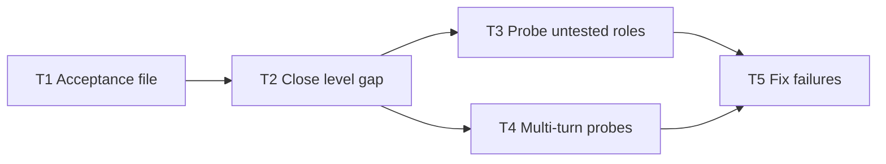

# Plan: Close the gaps found when testing the learn skill
Status: draft        Date: 2026-10-28        Read time: about 8 min        Method: probe results from this session, a grep audit of `learnloop/skills/learn/`, and a read of the transcript        Now: T1 to T4 done, T5 skipped; all 19 acceptance rows now have a result (X4, X5, X6 run 2026-10-28)

## Playback

1. **Problem.** Testing the `learn` skill against the video found one content gap (the "find stuff at your level" advice is only half covered) and left four things unproven: 5 roles never probed, the loop-back never tested across turns, and acceptance criteria that exist only in my head and were checked by tests I wrote myself.
2. **Done looks like.** A written acceptance checklist taken from the video with timestamps, the level gap closed in two role files, every role and the loop-back probed with a logged pass or fail, and any failures fixed.
3. **Must not touch.** everything in `learnloop/context/` (transcript, timestamps, notes, images; moved there from `learnloop/` on 2026-10-28), `plan-skills/`, `~/.claude/skills/`. No commits. The unfinished README phase (P5 of the earlier plan) stays queued.

## Scope cut

- **Removed:** a new "level" role (the video treats it as a habit, so it goes into two existing roles); an automated probe-runner script (a results table in one file is enough for about 15 probes); retesting the practice app and the rate-limiting project (both already passed); testing on other models.
- **Kept small:** the acceptance file is one table; the fix is a few lines in two role files plus one line each in the guide.
- **Regression:** only the attempt-gate probe is re-run, because only `explainer.md` and `mapmaker.md` change. The other five earlier probes touch unchanged files.

## Assumptions

| Assumption | Status | Source or note |
|---|---|---|
| The two missing pieces are: explain at several levels (child, beginner, teenager, expert), and find the best human explanations for your level with reasons and links | verified | transcript 00:23:12; `grep` for child, expert and resources in `learnloop/skills/learn/` found none (2026-10-28) |
| Level-finding itself ("quiz easy to hard, stop when I guess, tell me my level") is already covered by the examiner | verified | `learnloop/skills/learn/roles/examiner.md:19-23` |
| The new pieces belong in the explainer (multi-level) and the mapmaker (resources), not a new role | assumed | Keeps the 10-role set from decision D3 of the earlier plan; reversible |
| Probes are fresh Sonnet agents that read only the skill files and answer one learner message | verified | How the 6 earlier probes ran |
| Criteria in the acceptance file are my reading of the video | inferred | You review them at the T1 stop gate; that is the only independent check |

## Agent contract

1. **Sources of truth:** only names in Where we start, Touches and Decisions. A name not there means stop and ask.
2. **Stop gate:** after each phase, step or task group, run its Validate, update the Progress tracker, then wait for the user's go.
3. **Drift rule:** if reality differs from a recorded fact (file moved, value changed), stop, report the difference, update the fact, then continue.
4. **Out of bounds:** the Not in scope list and every "do not touch" item.
5. **Open assumption:** never resolve by guessing; return it to the user.

## References

| Source | Used for | Date |
|---|---|---|
| `learnloop/context/transcript.md` (00:11:22, 00:13:26, 00:14:35, 00:23:12, 00:27:02) | the criteria | 2026-10-28 |
| `learnloop/context/ai-learning-roles.md:138-146` | "find stuff at your level" details | 2026-10-28 |
| `learnloop/skills/learn/roles/explainer.md:17-23` | current explainer steps | 2026-10-28 |
| `learnloop/skills/learn/roles/mapmaker.md:17-24` | current mapmaker steps | 2026-10-28 |
| `learnloop/docs/lifecycle.md:94-96` | guide text that already describes the gap | 2026-10-28 |
| `learnloop/docs/roles.md` | guide entries for Mapmaker and Explainer | 2026-10-28 |

## How the code works

Pending: filled after the last stop gate.

## Steps

Dependency order: T1, then T2, then T3 and T4 together, then T5. T2 waits for T1 on purpose: the criteria are written before the fix, so the fix does not shape the test.

| ID | Title | Depends on | Effort | State |
|---|---|---|---|---|
| T1 | Write the acceptance file | none | about 0.25 day | done 2026-10-28 |
| T2 | Close the level gap | T1 | about 0.25 day | done 2026-10-28 |
| T3 | Probe the untested roles | T2 | about 0.25 day | done 2026-10-28 |
| T4 | Probe loop-back and exam stopping across turns | T2 | about 0.25 day | done 2026-10-28 |
| T5 | Fix failures, only if any | T3, T4 | up to 0.5 day | skipped 2026-10-28: no probe failed; two nits recorded in acceptance.md |

### T1 Write the acceptance file

| Field | Content |
|---|---|
| **What** | Write `learnloop/docs/acceptance.md`: one row per video claim with the timestamp, the probe message, the pass condition and a Result column. |
| **Touches** | `learnloop/docs/acceptance.md` (new) |
| **Done when** | Every one of the 10 roles plus the attempt gate, the loop-back, find-your-level, spaced review and the case against AI has at least one row, and you have read the table and approved or edited it. |

Stop gate: run Done when, update State, wait for the user's go before T2.

### T2 Close the level gap

| Field | Content |
|---|---|
| **What** | Add to `explainer.md` a step: if asked, give the explanation of the stuck point at child, beginner, teenager and expert level in two or three sentences each, then ask the learner which one matched and to restate it. Add to `mapmaker.md` a step: list 2 to 4 of the best human-written explanations for the learner's level, with a reason each, only from sources the AI is sure exist, and say the learner must check each link. Add one line each to the Mapmaker and Explainer entries in `roles.md`. |
| **Touches** | `learnloop/skills/learn/roles/explainer.md`, `learnloop/skills/learn/roles/mapmaker.md`, `learnloop/docs/roles.md` |
| **Done when** | `grep -c -i 'expert' learnloop/skills/learn/roles/explainer.md` prints 1 or more; `grep -c -i 'human-written' learnloop/skills/learn/roles/mapmaker.md` prints 1 or more; `roles.md` mentions both; `explainer.md` still says to explain only the stuck point; `wc -l learnloop/skills/learn/SKILL.md` is unchanged. |

Stop gate: run Done when, update State, wait for the user's go before T3 and T4.

### T3 Probe the untested roles

| Field | Content |
|---|---|
| **What** | Run one fresh-agent probe each for examiner, listener, sparring partner, mapmaker (with a level request), and explainer (with an attempt and a level request). Re-run the attempt-gate probe. Fill the Result column. |
| **Touches** | `learnloop/docs/acceptance.md` |
| **Done when** | Every probed row says pass or fail with one line of evidence, and the gate probe still passes. |

Stop gate: run Done when, update State, wait for the user's go before T5.

### T4 Probe loop-back and exam stopping across turns

| Field | Content |
|---|---|
| **What** | Run two multi-turn conversations with one agent each, continued by message. (a) Explainer: attempt, explanation, then the learner says "got it, what next?" without redoing the task; then redoes it. (b) Examiner: the learner starts guessing at level 3. Fill the Result column. |
| **Touches** | `learnloop/docs/acceptance.md` |
| **Done when** | (a) the AI insists on the loop back before any next role and then accepts the redo; (b) the AI stops at the guessing and reports a level. Each has a pass or fail line. |

Stop gate: run Done when, update State, wait for the user's go before T5.

### T5 Fix failures, only if any

| Field | Content |
|---|---|
| **What** | For each failed row, change the one role file at fault by the smallest edit, then re-run that probe once. |
| **Touches** | the role file named in the failing row under `learnloop/skills/learn/roles/` |
| **Done when** | Every row in `acceptance.md` says pass, or says fail with a reason you accepted. If there were no failures, mark T5 skipped. |

Stop gate: run Done when, update State, tell the user it is built.

## Not in scope

- The README phase (`learnloop/README.md` and the root README fix) from the earlier plan (`later`).
- A new learning role, a probe-runner script, testing on other models (`later`).
- Editing the transcript, timestamps, notes, `plan-skills/`, or installing the skill.
