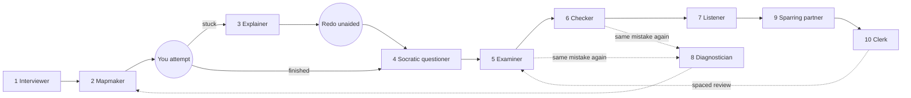

# The 10 learning roles

Learning is production, not consumption: recalling, predicting, explaining and doing are what make knowledge stick. Most people use AI only as an **Explainer**, which is passive. The other nine roles make you produce something, or check something you produced.

Each role below says what it is for, when to use it, what you bring, what you get, and which roles come before and after. The exact prompt and the rules for each role live in its own file under [`../skills/learn/roles/`](../skills/learn/roles/); this page does not repeat them. For how the roles fit together over time, read [lifecycle.md](lifecycle.md).

## Role map

This diagram shows which role usually follows which. Solid arrows are the normal path; dotted arrows are loops you take when something goes wrong or time passes.

## Quick chooser

| Your situation | Role |
|---|---|
| I don't know what I need to learn or how I'll be tested | [Interviewer](#1-interviewer) |
| The subject feels shapeless, I have no plan | [Mapmaker](#2-mapmaker) |
| I tried and I'm truly stuck on one part | [Explainer](#3-explainer) |
| I think I understand it | [Socratic questioner](#4-socratic-questioner) |
| I want a score and to know my level | [Examiner](#5-examiner) |
| I made something (summary, proof, code) | [Checker](#6-checker) |
| I want to explain it back in my own words | [Listener](#7-listener) |
| The same mistake keeps coming back | [Diagnostician](#8-diagnostician) |
| I need to perform a real-world skill | [Sparring partner](#9-sparring-partner) |
| I have messy notes | [Clerk](#10-clerk) |

## 1. Interviewer

- **Purpose:** find your real goal, level, test format and timeline before anything is taught. "Learn coding" often turns out to be "pass a live-coding interview in 3 weeks", which changes what you study.
- **Use when:** you are starting out and don't know enough to know what you don't know.
- **You bring:** a vague wish ("I want to learn X") and honest, specific answers. Vague answers produce vague plans.
- **You get:** a one-page learning brief (goal, level, how you'll be tested, timeline).
- **Connects:** first role in the lifecycle. Feeds the [Mapmaker](#2-mapmaker). Prompt: [interviewer.md](../skills/learn/roles/interviewer.md).

## 2. Mapmaker

- **Purpose:** turn a shapeless subject into a curriculum, so you always know what to do next. Without a plan, much of your energy goes to worrying about what comes next.
- **Use when:** you have a goal but no roadmap, or after the [Diagnostician](#8-diagnostician) finds a gap you need to plan around.
- **You bring:** the brief from the Interviewer.
- **You get:** a map with the main parts, what depends on what, where people usually get stuck, and which role to run at each step. It also gives a dated schedule working back from your deadline, a final rehearsal in the format you will be tested in, a "cut first" list if you fall behind, and the best resources grouped as articles, video playlists and books, each with a reason. Check every link yourself.
- **Connects:** follows the Interviewer. After it, you attempt the first part yourself. Prompt: [mapmaker.md](../skills/learn/roles/mapmaker.md).

## 3. Explainer

- **Purpose:** explain just the part you are stuck on, at your level. It is the only role that consumes rather than produces, so it is used sparingly.
- **Use when:** you already attempted the task and are truly stuck. The learn skill will not run it before you paste an attempt.
- **You bring:** your attempt and the exact point where you got stuck.
- **You get:** a short explanation of that one part. On request, the same explanation at four levels (child, beginner, teenager, expert), so you can see which level you are at and what vocabulary you are missing.
- **Connects:** after an attempt. It must be followed by a **loop back**: redo the whole task from the start without help. If you can't redo it, you read about it but did not learn it. Prompt: [explainer.md](../skills/learn/roles/explainer.md).

## 4. Socratic questioner

- **Purpose:** expose gaps you didn't know you had by asking questions instead of giving answers ("why does this work?", "what if the input doubles?").
- **Use when:** you think you understand a topic, usually because something was just explained to you.
- **You bring:** the topic and your current understanding.
- **You get:** a list of questions you could and could not answer, which shows what to study.
- **Connects:** after the loop back. A gap here sends you back to the [Explainer](#3-explainer) for that gap, or to the [Mapmaker](#2-mapmaker) for a new part of the map. Prompt: [socratic-questioner.md](../skills/learn/roles/socratic-questioner.md).

## 5. Examiner

- **Purpose:** quiz you at rising difficulty, one question at a time, and find the level where you stop passing. That level is where to study next.
- **Use when:** you have covered a topic once and want a score, or when a spaced review is due.
- **You bring:** the topic and a way to answer (typed or spoken).
- **You get:** a level (for example "passed 1 to 3, failed 4") and a list of missed items.
- **Connects:** after the Socratic questioner. Missed items become flashcards via the [Clerk](#10-clerk); repeated misses go to the [Diagnostician](#8-diagnostician). Prompt: [examiner.md](../skills/learn/roles/examiner.md).

## 6. Checker

- **Purpose:** grade your process and reasoning, like "show your work" in a maths class, not only your final result. It can find a shorter route so next time your process is faster.
- **Use when:** you made something: a summary, a proof, code, a calculation.
- **You bring:** your work and, if you have one, a rubric.
- **You get:** what is wrong or missing, and whether a faster way exists. It does not rewrite your work.
- **Connects:** after you produce something. Findings go to the mistake log, which the [Diagnostician](#8-diagnostician) reads. Prompt: [checker.md](../skills/learn/roles/checker.md).

## 7. Listener

- **Purpose:** test whether you can explain the topic in your own words, in several formats: spoken, drawn and written. The best learners can do all three.
- **Use when:** you want to be sure you understand a topic, not just recognise it.
- **You bring:** a voice-transcribed explanation, a quick sketch (described or photographed) and a short written summary, plus the source material.
- **You get:** a comparison against the source, with exactly what you missed or got wrong.
- **Connects:** after the Checker. Gaps loop back to the [Explainer](#3-explainer) or the [Examiner](#5-examiner). Prompt: [listener.md](../skills/learn/roles/listener.md).

## 8. Diagnostician

- **Purpose:** find the one root misunderstanding behind many mistakes, so you fix the cause and not each symptom.
- **Use when:** the same kind of mistake keeps coming back, or every few sessions as a routine check.
- **You bring:** your mistake log and recent session logs.
- **You get:** a short report naming the recurring error, the likely root cause, and what to study to fix it.
- **Connects:** reads the output of the [Examiner](#5-examiner), [Checker](#6-checker) and [Listener](#7-listener). Its report goes to the [Mapmaker](#2-mapmaker) to adjust the plan. Prompt: [diagnostician.md](../skills/learn/roles/diagnostician.md).

## 9. Sparring partner

- **Purpose:** simulate the real situation (an interview, a sales call, a talk, a negotiation) under pressure, so your first real attempt is not your first attempt.
- **Use when:** you are practising a skill you will perform in the real world.
- **You bring:** the scenario, the difficulty you want (shorter timer, tougher opponent) and, if possible, real examples to base it on.
- **You get:** a scored practice session with pushback on vague answers, and the weak answers listed.
- **Connects:** after you understand the material. Weak answers go to the [Clerk](#10-clerk) as new cards. This role also covers simulations and practice apps built by an AI agent. Prompt: [sparring-partner.md](../skills/learn/roles/sparring-partner.md).

## 10. Clerk

- **Purpose:** handle the logistics: turn messy notes into a clean outline and flashcards, and keep a review schedule. All the thinking stays yours.
- **Use when:** you have messy notes, or mistakes that should become flashcards.
- **You bring:** your own notes and the mistakes you logged.
- **You get:** a clean outline and a flashcard file. It adds nothing you did not write.
- **Connects:** last role of a pass. The cards come back later through spaced review into the [Examiner](#5-examiner). Rule of thumb: flashcards for details, explaining for connections. Prompt: [clerk.md](../skills/learn/roles/clerk.md).
