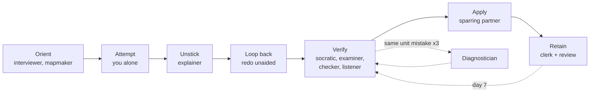

# Lifecycle example: learn HTTP rate limiting, then build it

> This conversation is written by hand to show how each role asks and answers. It is not a recorded AI session. The code in [project/](project/) is real: run `node --test` in that folder.

**Situation:** a take-home task due in 7 days: add a tested rate limiter to a small Node API and explain it on a call. The learner knows Node and HTTP basics and has never written a limiter.

The path below follows the [lifecycle](../../docs/lifecycle.md). Dotted arrows are the loops that happened.



## 1. Orient

**You:** `/learn interviewer HTTP rate limiting`

**AI (interviewer):** What is this for?

**You:** A take-home task. Add rate limiting to a Node API.

**AI:** That is still broad. How will it be judged, and when is it due?

**You:** A reviewer reads my code, runs my tests, then asks me to explain it on a call. Due in 7 days, about an hour a day.

**AI:** What do you already know?

**You:** Node `http` servers and status codes. I have never written a limiter.

**AI:** Here is your brief. Correct anything wrong.
- **Goal:** in 7 days, add a tested rate limiter to a Node server and explain every design choice on a call.
- **Skip:** Node and HTTP basics, Redis and distributed limiting.
- **Tested by:** a code and test review, then a spoken explanation.

**You:** Confirmed.

> **Exit check:** the goal changed from "learn rate limiting" to "build a tested limiter and explain it aloud", and the learner confirmed it.

**You:** `/learn mapmaker`

**AI (mapmaker):** Six parts, in order. Each lists where people get stuck.
1. Why limit; what 429 and `Retry-After` mean. *Stuck:* treating 429 as an error to hide.
2. Fixed window counter. *Stuck:* bursts at the window edge.
3. Token bucket. *Stuck:* time in milliseconds against a refill per second.
4. Write `createLimiter`. *Stuck:* partial tokens, clamping to capacity.
5. Wire it into a server. *Stuck:* one bucket for all clients against one per client.
6. Explain it aloud.

Your next task: write `take()` for a bucket with capacity 3 and 1 token per second, using a clock in milliseconds. Try it alone first.

> **Exit check:** the learner can name the next task.

## 2. Attempt, then unstick

**You:** `/learn explainer` I'm stuck on my limiter.

**AI (explainer):** Attempt gate: paste your attempt and tell me where you got stuck. I will not explain before you have tried.

**You:**
```js
tokens = Math.min(capacity, tokens + (t - last) * refillPerSec);
```
After 3 takes the 4th still returns `true`. `console.log(tokens)` prints a huge number although only a few milliseconds passed.

**AI:** I will explain only that. `Date.now()` counts milliseconds. `refillPerSec` is tokens per second. In `(t - last) * refillPerSec` the time is still in milliseconds, so each millisecond adds a whole second's refill: 1000 times too many. Convert first, then multiply: seconds times tokens per second gives tokens. Check: 500 ms at 1 per second should give 0.5 tokens.

Now finish the task. Then **redo the whole limiter from a blank file without looking at this.**

**You** (next day): Rebuilt it unaided in about 15 minutes. One test failed first: I used `tokens <= 0` instead of `tokens < 1`. I fixed it. All 5 tests pass.

> **Exit check:** the whole task was redone without help.

## 3. Verify

**You:** `/learn socratic-questioner token bucket`

**AI (socratic questioner):** Why does the bucket have a capacity at all?

**You:** It allows a burst but caps how big the burst can be.

**AI:** If the server sits idle for an hour, how many tokens does it hold?

**You:** `capacity`, because of the `Math.min`.

**AI:** Why refill when a request arrives instead of with a timer?

**You:** Not sure. Maybe it is easier?

**AI:** Noted as a gap. Next: your limiter sends `Retry-After`. What does a client do with it?

**You:** I do not know what `0` would mean.

**AI:** Two gaps: lazy refill, and `Retry-After`. Try each alone using your code first.

**You:** Lazy refill: no timer to manage, no work while idle, and the value is exact when I need it. I will look up `Retry-After` and tell you.

**You:** `/learn examiner token bucket`

**AI (examiner):** One question at a time. Level 1: what is `capacity`?

**You:** The most tokens the bucket holds.

**AI:** Right. Level 3: capacity 5, refill 1 per second. 12 requests arrive at the same instant. How many succeed?

**You:** 5 succeed, 7 fail.

**AI:** Right. Level 4: after those 12, you wait 2.5 seconds and send 3 requests. How many succeed?

**You:** 3.

**AI:** Wrong. 2.5 tokens is 2 whole tokens, so 2 succeed. Level 4, new case: capacity 2, refill 0.5 per second, bucket empty. What `Retry-After` do you send?

**You:** 2000.

**AI:** Wrong. It is 2 seconds. You are guessing now, so I stop. **Passed levels 1 to 3, failed 4.** Missed: partial tokens, and the unit of `Retry-After`.

**You:** `/learn checker` Here is my `limiter.js` and tests. *(pastes the code)*

**AI (checker):** I graded against five criteria and rewrote nothing.
- Correct token maths: **met**.
- Units stated and converted once: **partly**. `last` does not say it is milliseconds.
- `retryAfterSec` returns a whole number: **partly**. It returned `1.5`; a header needs whole seconds. Round up.
- Edge cases: **met**.
- Simplest route: **partly**. The refill lines appear in both `take()` and `retryAfterSec()`. One shared `refill()` is enough and means a unit bug can live in only one place.

**You:** Fixed all three myself. The code in [project/limiter.js](project/limiter.js) is the result.

**You:** `/learn listener` Here is my explanation of the token bucket, spoken, drawn and written. *(pastes transcript, sketch description and 3 lines)*

**AI (listener):** Compared with the source:
- **Correct:** capacity, refill rate, one token per request, lazy refill, 429 with `Retry-After`.
- **Missed:** why a token bucket beats a fixed window (a fixed window lets about double the limit through at the boundary); that refill is clamped to capacity after idle time.
- **Wrong:** nothing.

**You:** *(rewrites the two points in own words)* Re-run: no gaps.

> **Exit check:** level and findings recorded, gaps fixed by the learner.

## 4. Diagnose

Four mistakes so far: the 1000x refill, `Retry-After` in milliseconds, a float header, an unnamed unit.

**You:** `/learn diagnostician` Here is my mistake log. What do these have in common?

**AI (diagnostician):** One root cause, with high confidence: **you mix milliseconds and seconds and do not write the unit down.** All four mistakes are a time unit slipping between ms and s, in three different places (maths, a quiz answer, a header). They are gaps, not slips.

Small test: convert five time values between ms and s on paper, then predict the output of two small functions that take ms and seconds. If you get all seven right, the cause is cured. Then name every time variable with its unit.

**You:** 7 of 7. Renamed `last` to `lastMs` and added `elapsedSec`.

## 5. Apply

**You:** `/learn sparring-partner` Play a tough reviewer on my take-home call. One question at a time, 30 seconds each.

**AI (sparring partner):** Why a token bucket and not a fixed window?

**You:** It is more fair.

**AI:** Too vague. Fair how? Give a concrete case.

**You:** A fixed window lets about double the limit through around the boundary. A bucket caps any burst at its capacity.

**AI:** Your limiter is global. What breaks in production?

**You:** One noisy client uses everyone's tokens. Use one bucket per client.

**AI:** How do you key the buckets, and what stops the map growing forever?

**You:** Key by IP or API key. Drop buckets that have been idle a while.

**AI:** Score 11 of 15 against a target of 12. Weak answers: the first (lead with the concrete case) and the per-client design. Practise those next.

The project is the other half of applying it. Run it:

```
cd project
node --test          # 5 tests, all pass
node server.js       # then, in another terminal:
for i in $(seq 1 12); do curl -s -o /dev/null -w '%{http_code} ' localhost:3000/ping; done
```

With capacity 5 and a refill of 1 per second, the first 5 requests return `200` and the rest return `429` with a `Retry-After` header. Set `PORT`, `CAPACITY` and `REFILL_PER_SEC` to change them. The limiter is a teaching toy: one global bucket, no per-client keys, no cleanup. The sparring session named that gap on purpose.

## 6. Retain

**You:** `/learn clerk` Turn my messy notes into a clean outline. Don't add anything I didn't write. Then make flashcards. Notes: *"429 = too many. retry-after secs not ms!! fixed window edge burst double. bucket cap + refill. lazy refill no timer. clamp min(cap...). tokens<1 not <=0. global vs per client, key by ip, drop idle. units!!! lastMs elapsedSec"*

**AI (clerk):**
1. **Response:** 429 means too many requests; `Retry-After` is whole seconds, not milliseconds.
2. **Fixed window:** a burst at the window edge can double the limit.
3. **Token bucket:** capacity plus refill rate; lazy refill with no timer; clamp at capacity; a token is available when `tokens >= 1`.
4. **Design:** global against per client; key by IP; drop idle buckets.
5. **Habit:** name every time variable with its unit.

I added nothing. One note to check yourself: "key by ip" can be wrong behind a proxy.

Cards, for the [practice app](../practice-app/) (one idea each):
```json
[
  {"front": "What unit does Retry-After use here?", "back": "Whole seconds, rounded up; never milliseconds.", "source": "rate limiting"},
  {"front": "Why does a token bucket beat a fixed window at the window edge?", "back": "A fixed window lets about double the limit through at the boundary; a bucket caps any burst at capacity.", "source": "rate limiting"},
  {"front": "Why compute refill lazily instead of with a timer?", "back": "No timers; no work while idle; exact when needed.", "source": "rate limiting"},
  {"front": "Date.now() and refillPerSec use which units?", "back": "Milliseconds and tokens per second. Convert once: elapsedSec = (nowMs - lastMs) / 1000.", "source": "rate limiting"}
]
```

Review schedule: day 1, 3, 7, 21 (the default, an assumption).

**Day 7 review.** **You:** `/learn examiner` Spaced review of token buckets. **AI:** Passed levels 1 to 4; failed level 5 (a per-client design question). The unit mistakes did not come back. Next review: day 21.

## What this shows

- Every role asked or answered something small and ended with a checkable exit.
- The unit mistake showed up across four roles. Only the diagnostician could see it as one cause.
- The attempt gate, the loop back and the spaced review turn an explanation into learning.

To try it yourself, copy the [templates](../templates/) and run `/learn auto <your topic>`.
